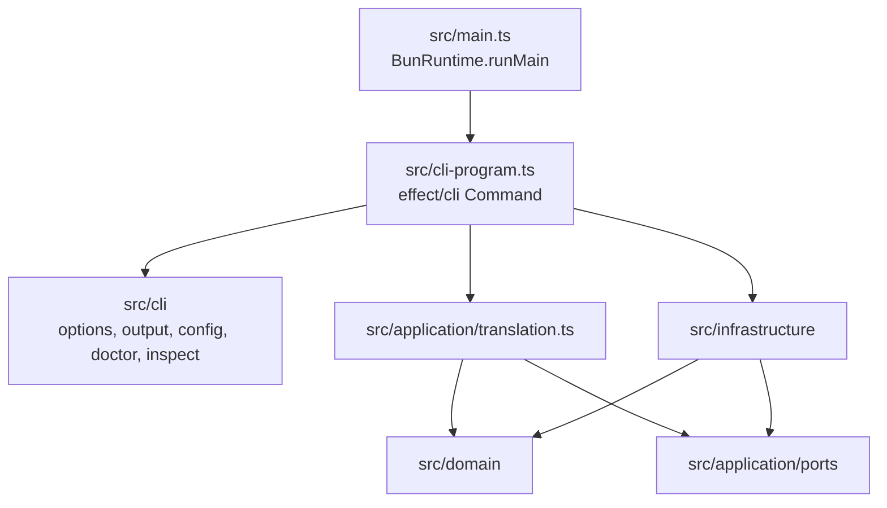

# Architecture

## 모듈 구조

- `src/domain`: 순수 타입·프리셋·프롬프트 조립·검증, `Schema.TaggedError` 오류 정의.
- `src/application`: 번역 유스케이스. `LanguageModel`, `Clipboard`, `AppConfigService` 서비스에만 의존.
- `src/infrastructure`: OpenAI/OpenRouter/Google Provider 레이어, YAML 설정 로더, macOS 클립보드 어댑터.
- `src/cli`: `effect/cli` 플래그·프롬프트·출력과 `--init`, `--doctor`, `--load-show` 처리.
- `src/scripts`: 릴리스 도구. Effect 없이 Bun API만 사용.

## Effect v4 규칙

| 목적 | 사용 |
| --- | --- |
| 서비스 정의 | `Context.Service<Self, Shape>()("id")` |
| 레이어 제공 | `Layer.succeed(tag, value)`, `Layer.mergeAll`, `Layer.provide` |
| 오류 | `Schema.TaggedError` (`ConfigError`, `ProviderError`, `TranslationError`, `ClipboardError`) |
| 설정 파싱 | `Schema.decodeUnknownEffect` |
| CLI | `effect/cli`의 `Command`, `Flag`, `Argument`, `Prompt` |
| 파일/경로 | `effect/FileSystem`, `effect/Path` (런타임은 `BunServices.layer`) |
| HTTP | `effect/http`의 `HttpClient`, `FetchHttpClient.layer` |
| 진입점 | `BunRuntime.runMain(effect, { disableErrorReporting: true })` |

v3의 `Context.Tag`, `Effect.catchAll`, `@effect/cli`, `@effect/ai`는 사용하지 않는다.
Boolean 플래그는 v4에서 기본값이 없으므로 `Flag.withDefault(false)`를 명시한다.

## Provider 매트릭스

| Provider | 패키지 | API | 기본 URL |
| --- | --- | --- | --- |
| OpenAI | `@effect/ai-openai` | Responses | `https://api.openai.com/v1` |
| OpenRouter | `@effect/ai-openrouter` | Chat Completions | `https://openrouter.ai/api/v1` |
| Google Gemini | `@effect/ai-openai-compat` | Chat Completions | `https://generativelanguage.googleapis.com/v1beta/openai` |

모든 Provider는 `LanguageModel.LanguageModel` 레이어를 제공하며, 요청별 `temperature`/`maxTokens`는 각 패키지의 `withConfigOverride`로 적용한다.
OpenAI는 `max_output_tokens`, OpenAI 호환 Provider는 `max_tokens`를 사용한다.

`tsl --doctor`는 인증이 필요한 엔드포인트로 키를 검증한다. OpenRouter의 `/models`는 공개 엔드포인트라 잘못된 키도 200을 반환하므로 `/key`를 사용한다. OpenAI/Google은 `/models`를 사용한다.

## 설정 해석

0. 경로: `--config-path` > `$XDG_CONFIG_HOME/tsl/config.yaml` > `$HOME/.config/tsl/config.yaml`. YAML만 읽는다.
1. `Bun.YAML.parse`로 YAML을 읽고 `Schema`로 부분 문서를 검증한다.
2. `profiles`는 `defaultProfiles`에 덮어쓴다.
3. `apiKey`의 `${ENV:NAME}`은 `Bun.env`에서 해석한다.
4. `--load-show`는 해석 결과를 출력하되 `apiKey`를 `***`로 마스킹한다.

## 테스트

- `bun test`
- 도메인: 프롬프트 조립, 설정 병합, API 키 마스킹.
- 애플리케이션: 가짜 `LanguageModel` 레이어로 샘플 수·순서·빈 응답·클립보드 동작 검증.
- CLI: `Command.runWith` + `TestConsole` + 실제 `BunServices.layer`로 플래그와 `--doctor` 검증.
- 로컬 HTTP 서버(`Bun.serve`)로 Provider 및 `--doctor` 연결 점검.
